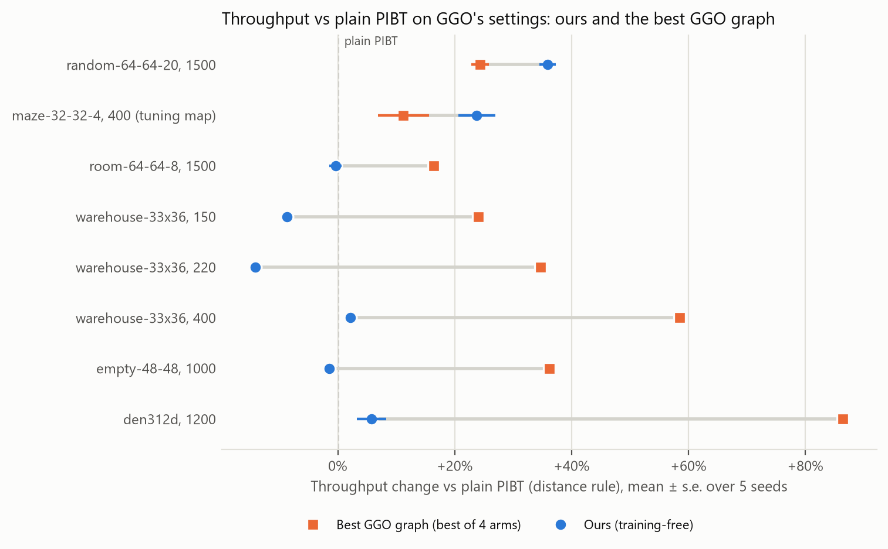

# Training-Free Online Guidance for Lifelong Multi-Agent Path Finding

Manit Agarwal · research in progress (updated 27 October 2026)

In lifelong multi-agent path finding (MAPF), hundreds of robots share a grid map and receive a new
goal as soon as they reach the current one, so throughput collapses when crowds form. Guidance Graph
Optimization (GGO) addresses this by optimizing the planner's edge weights offline for a given map and
agent count. This project guides the PIBT planner **without training**: there is no per-map or
per-agent-count optimization, only one global parameter setting. Each robot reads two live signals
computed from the current traffic, a smoothed map of where crowding is building up and a trail left by
recent movement, and uses them to choose its route and its next move. In addition, a few small groups of
robots that stand close together and head to the same area get right of way and travel in single file
behind a leader, while the other robots make room. Traffic rules such as one-way lanes can **emerge**
from these signals instead of being designed by hand. An earlier version that used the movement trail
alone (not the configuration in the table below; measured in early October 2026, before the repository
was under version control) made the side aisles of the warehouse-33x36 map with 150 agents one-way (3
seeds). One-wayness of an aisle gap is |down − up| / (down + up) of the robots crossing it, from 0
(equal traffic both ways) to 1 (all one way): 0.92–0.94 for the trail, against 0.10–0.19 for plain PIBT
and 0.88–0.96 for GGO's optimized graph (the crisscross baseline enforces this by design). The middle
aisles stayed two-way, and at 400 agents the effect is weaker (0.58–0.82).

## Results

Throughput (tasks completed per step), mean ± standard error over 5 seeds, on the PIBT settings for which
GGO's repository provides optimized guidance graphs, except random-32-32-20 (see below). "Ours" is my
training-free method. Best in each row in bold. Two priority rules decide which robot plans first:
**GGO's rule** (the robot that received its goal longest ago) and the **distance rule** my method uses
(the robot closer to its goal, with a little random noise). **GGO gets its best arm per setting:** the
better of its two published graphs (CMA-ES and PIU), each run with both rules, picked on the same seeds
that are reported, which favours GGO. Plain PIBT uses the distance rule, like my method. No run uses the
swap operation. A seed counts as won or lost when my method is more than 3% above or below the best GGO
arm on that seed, and as tied otherwise. GGO's graphs were optimized for exactly these settings, but in
GGO's own C++ simulator; their performance can change in my re-implementation, so this is not a
reproduction of the GGO paper. † maze-32-32-4 is the map my method's settings were tuned on (see
**Setup**).

| Map | Agents | PIBT (plain) | Best GGO graph | Ours (training-free) | Ours vs plain PIBT | Ours vs best GGO | Seeds won / tied / lost |
|---|---|---|---|---|---|---|---|
| random-64-64-20 | 1500 | 8.38 ± 0.12 | 10.41 ± 0.12 (PIU, distance rule) | **11.38 ± 0.12** | +35.9% | +9.3% | 5 / 0 / 0 |
| maze-32-32-4 † | 400 | 1.30 ± 0.04 | 1.44 ± 0.06 (PIU, GGO's rule) | **1.61 ± 0.04** | +23.8% | +11.3% | 3 / 2 / 0 |
| room-64-64-8 | 1500 | 2.90 ± 0.03 | **3.38 ± 0.01** (CMA-ES, distance rule) | 2.89 ± 0.03 | -0.4% | -14.5% | 0 / 0 / 5 |
| warehouse-33x36 | 150 | 3.84 ± 0.02 | **4.76 ± 0.02** (PIU, GGO's rule) | 3.51 ± 0.02 | -8.6% | -26.3% | 0 / 0 / 5 |
| warehouse-33x36 | 220 | 4.75 ± 0.03 | **6.40 ± 0.03** (PIU, distance rule) | 4.08 ± 0.03 | -14.2% | -36.3% | 0 / 0 / 5 |
| warehouse-33x36 | 400 | 4.82 ± 0.01 | **7.64 ± 0.03** (CMA-ES, distance rule) | 4.93 ± 0.02 | +2.2% | -35.5% | 0 / 0 / 5 |
| empty-48-48 | 1000 | 19.12 ± 0.13 | **26.05 ± 0.03** (PIU, distance rule) | 18.85 ± 0.07 | -1.4% | -27.6% | 0 / 0 / 5 |
| den312d | 1200 | 2.74 ± 0.03 | **5.10 ± 0.02** (CMA-ES, distance rule) | 2.89 ± 0.07 | +5.8% | -43.3% | 0 / 0 / 5 |

<picture>
  <source media="(prefers-color-scheme: dark)" srcset="figures/change_vs_plain_dark.png">
  
</picture>

**My method beats GGO's best graph on 2 of the 8 settings and loses on 6.** It wins on random-64-64-20
(+9.3%, all 5 seeds) and maze-32-32-4 (+11.3%, 3 seeds won and 2 tied; the tuning map). These are maps
where plain PIBT ends in a partial gridlock but free space is left. There my method reduces the
long-waiting agents, those still on a task they received 250 or more steps earlier at the end of the
episode (random-64-64-20: 506 → 165 of 1500 agents; maze-32-32-4: 356 → 246 of 400, means over 5 seeds),
and gains 24–36% over plain PIBT. It loses by 14–43% on the other six. On warehouse-33x36 and
empty-48-48 plain PIBT does not gridlock; my method is no better than plain PIBT there (-14.2% to +2.2%),
while GGO's best graphs gain +24% to +58% over plain PIBT. On room-64-64-8 and den312d, 66–71% of agents
are long-waiting under both plain PIBT and my method, so my method barely changes the jam; GGO's graphs
reduce it most on den312d (to 48–49%). In short, the method relieves some gridlocks but does not yet
improve flow on maps where traffic already flows.

**random-32-32-20 is left out.** With GGO's priority rule, my PIBT scores far below the GGO paper on this
map: plain PIBT 1.52 vs 5.52 and GGO CMA-ES 1.82 vs 7.78. A second PIBT simulator I wrote separately
(not using POGEMA's simulator) shows what happens: by the end of the episode 100% of agents are stuck (no
net progress in the last 50 steps). With the distance rule the gridlock mostly disappears (plain PIBT
4.51), but GGO CMA-ES still reaches only 5.86 against the paper's 7.78, so the difference between my
implementation and GGO's simulator is not yet found. For completeness, my method scores 5.95 there. On
random-64-64-20, room-64-64-8 and maze-32-32-4, my plain PIBT with GGO's rule is within 7% of the
paper's values; on den312d it is 2.59 vs 3.05.

**Swap.** GGO's code runs PIBT without the swap operation, and so does every run in the table. Swap
helps plain PIBT a lot where it gridlocks: in my second simulator, on random-64-64-20 with GGO's rule,
it raises plain PIBT from 5.90 to 9.17, and with the distance rule and swap plain PIBT reaches 9.37.
With the distance rule and swap, GGO's graphs reach 10.58 (CMA-ES) and 10.76 (PIU) there, still below my
method's 11.38 without swap, and the two simulators agree where both were run (GGO PIU, distance rule,
no swap: 10.41 vs 10.42). My method has not yet been run with swap.

**Setup.** Lifelong MAPF: each agent gets a new goal when it reaches its current one, episodes of 1000
steps. All results in the table run in my own Python implementation of PIBT on the POGEMA simulator, and
GGO's published guidance graphs are loaded unchanged into the same planner. Absolute numbers therefore
differ from the GGO paper. One parameter setting is used for every row of the table. **How it was
chosen:** candidate settings for the two traffic signals came from a small search on separate seeds
(100–102) of random-32-32-20 (400 agents), maze-32-32-4 (400) and room-64-64-8 (500). Two of these
candidates had also been run on seeds 0–4 of random-64-64-20 and room-64-64-8 with 1500 agents before the
choice between them. The group rule was developed on maze-32-32-4, warehouse-33x36 (400) and
room-64-64-8 (500), and the final combination was chosen on maze-32-32-4 alone, out of 9 combinations on
seeds 200–201 (checked on 200–203). Seeds 0–4 were also used during development, so they are not a
held-out test set; a held-out evaluation is planned. In Python my method is 3 to 12 times slower per
episode than plain PIBT. Per-seed results are in [results/](results/).

## Learned extension (in progress)

Separate from the training-free method, I am testing whether learning helps where PIBT gridlocks. A
value network (a U-Net with about 1.2 million parameters that reads a picture of the map, the agents and
their recent movement and predicts each agent's progress) is trained once, on recorded plain-PIBT
episodes of all nine GGO settings (training seeds 20–49, early stopping on seeds 50–54). At each step
it picks the 8 moving agents it predicts are closest to freezing. For each of them it tries every other
move for one step and scores the result by that step's progress plus the network's predicted progress
over the next 10 steps; at most 2 changes per step are kept, and only clear improvements. These results
are from my second simulator; every PIBT-based column uses the distance rule and swap, except the best
GGO graph, which is the best of both rules with and without swap. Seeds 0–4:

| Map | Agents | PIBT (plain) | Best GGO graph | WPPL (1 thread) | Random agents, no network | Learned (in progress) | Learned vs plain PIBT |
|---|---|---|---|---|---|---|---|
| maze-32-32-4 | 400 | 1.35 | 1.45 (PIU, GGO's rule, no swap) | 1.36 | 1.64 | **2.28** | +69.1% |
| room-64-64-8 | 1500 | 2.89 | **3.37** (CMA-ES, distance rule, no swap) | – | 2.98 | 3.00 | +3.7% |
| den312d | 1200 | 2.74 | **5.10** (CMA-ES, distance rule, swap) | – | 3.10 | 3.05 | +11.2% |

- **On maze-32-32-4 it prevents most of the gridlock:** 23% of agents are stuck at the end (no net
  progress in the last 50 steps), against 68% for plain PIBT.
- **Against WPPL**, the winning planner of the League of Robot Runners 2023 competition: +68.4% on
  average, ahead on all 5 seeds, on maze-32-32-4 only. I ran the no-rotation version in GGO's
  repository on the same tasks, with the competition settings of MAPF-LRR2023's random-32-32-20
  configuration and no map-specific weights. That version fixes its search to one thread, and it used
  about 0.95 s of planning per step. The original uses all CPU cores, so this is not WPPL's strongest
  configuration.
- **The network's choice of agents matters:** with the network choosing the agents but moves scored only
  by their one-step progress (no network), the gain is +60.3%; with 8 randomly chosen agents and the
  same scoring, +21.8%.
- **It does not carry over yet:** on room-64-64-8 and den312d, randomly chosen agents do as well as the
  network's, and GGO's graphs are well ahead on both. Each episode takes about 75 times longer than plain
  PIBT.
- **Not held out:** maze-32-32-4 was the only map tried before this result, and an earlier pilot
  ran on its seeds 0–2. Per-seed results are in [results/](results/).

## Code

The code is not public yet because a paper is in preparation. It is available on request for
academic review: [manit.agarwal21@gmail.com](mailto:manit.agarwal21@gmail.com).

**Code fingerprint.** The code and every result file behind this page are in my private repository
at commit

`8956b8ec2e4e66bb6d1d18026f9fba83efd87727`

A commit ID is a cryptographic hash that covers every tracked file in the repository and its full history,
so changing any file would change it. The code at this commit passes the 15 short reference episodes in
its test suite (recorded from the first snapshot of the code), and re-running it reproduces exactly the 6
episodes I re-ran: all 5 seeds of the learned maze-32-32-4 result and seed 0 of my training-free method
on maze-32-32-4. The trained network's weights are kept outside version control; their SHA-256 hash is
recorded at this commit. The results on this
page were produced between 19 and 22 October 2026 by earlier commits of the same repository, apart from
the lane measurement (see above). The first version of this page (19 October 2026) gave commit
`9907e396e34a83414031e88b38c6522d65e646c8`, which is part of this commit's history. When I share the
repository, anyone can check the ID with `git rev-parse --verify <the ID above>^{commit}`.

## Credits

This work builds on the following. None of their code or data files are included in this repository.

- **PIBT.** K. Okumura, M. Machida, X. Défago, Y. Tamura. *Priority Inheritance with Backtracking for
  Iterative Multi-agent Path Finding.* IJCAI 2019; extended version in *Artificial Intelligence* 310,
  103752, 2022. The planner used here is my own Python re-implementation, written to follow the PIBT
  settings in GGO's code (its fork of WPPL: H. Jiang, Y. Zhang, R. Veerapaneni, J. Li, *Scaling Lifelong
  Multi-Agent Path Finding to More Realistic Settings: Research Challenges and Opportunities*, SoCS 2024).
  On maze-32-32-4 with 400 agents and the same tasks, WPPL's own one-step PIBT gives 1.03 and my second
  simulator's PIBT (GGO's rule, no swap) 1.08.
- **GGO.** Y. Zhang, H. Jiang, V. Bhatt, S. Nikolaidis, J. Li. *Guidance Graph Optimization for Lifelong
  Multi-Agent Path Finding.* IJCAI 2024. [arXiv:2402.01446](https://arxiv.org/abs/2402.01446).
  Code: [lunjohnzhang/ggo_public](https://github.com/lunjohnzhang/ggo_public), commit `d8de695` (its
  README states the code is under the MIT License, except `RHCR/`, which I did not use). From that
  repository I used the map files, GGO's published optimized guidance graphs (CMA-ES and PIU) and the
  crisscross baseline graphs. GGO's optimizer and update models were not run.
- **WPPL** (the learned extension's baseline), the winning planner of the League of Robot Runners 2023
  competition: Jiang et al., SoCS 2024 (cited above). I built the version in GGO's repository (commit
  `d8de695`) without changing its planner code, only build settings for a newer compiler.
- **Swap operation**: from LaCAM2, the code of K. Okumura, *Improving LaCAM for Scalable Eventually
  Optimal Multi-Agent Pathfinding*, IJCAI 2023 ([Kei18/lacam2](https://github.com/Kei18/lacam2), MIT
  License). My Python port follows its version in
  [DiligentPanda/MAPF-LRR2023](https://github.com/DiligentPanda/MAPF-LRR2023) (MIT License; Jiang et al.,
  SoCS 2024, cited above).
- **Crisscross** follows L. Cohen, *Efficient Bounded-Suboptimal Multi-Agent Path Finding and Motion
  Planning via Improvements to Focal Search*, PhD thesis, University of Southern California, 2020 (as
  defined in GGO).
- **Maps.** random-32-32-20, random-64-64-20, room-64-64-8, maze-32-32-4, empty-48-48 and den312d
  come from the MovingAI benchmarks (layouts identical to the MovingAI files; MovingAI data is under
  the Open Data Commons Attribution License): R. Stern et al., *Multi-Agent Pathfinding: Definitions,
  Variants, and Benchmarks*, SoCS 2019, and N. Sturtevant, *Benchmarks for Grid-Based Pathfinding*,
  IEEE Transactions on Computational Intelligence and AI in Games 4(2), 2012. den312d is a map from the
  game *Dragon Age: Origins* (BioWare), distributed through that benchmark.
- **Warehouse.** The warehouse-33x36 map and its task setup come from J. Li, A. Tinka, S. Kiesel,
  J. W. Durham, T. K. S. Kumar, S. Koenig, *Lifelong Multi-Agent Path Finding in Large-Scale
  Warehouses*, AAAI 2021, and Y. Zhang, M. C. Fontaine, V. Bhatt, S. Nikolaidis, J. Li, *Multi-Robot
  Coordination and Layout Design for Automated Warehousing*, IJCAI 2023; I used the version in GGO's
  repository.
- **POGEMA** (MIT License). A. Skrynnik, A. Andreychuk, A. Borzilov, A. Chernyavskiy, K. Yakovlev,
  A. Panov. *POGEMA: A Benchmark Platform for Cooperative Multi-Agent Pathfinding.* ICLR 2025.
  [Cognitive-AI-Systems/pogema](https://github.com/Cognitive-AI-Systems/pogema). Also
  [pogema-toolbox](https://github.com/Cognitive-AI-Systems/pogema-toolbox) (Apache License 2.0).
- **Ant colony optimization**, the inspiration for the movement-trail signal: M. Dorigo, V. Maniezzo,
  A. Colorni. *Ant System: Optimization by a Colony of Cooperating Agents.* IEEE Transactions on Systems,
  Man, and Cybernetics, Part B 26(1), 1996.
- **U-Net.** O. Ronneberger, P. Fischer, T. Brox. *U-Net: Convolutional Networks for Biomedical Image
  Segmentation.* MICCAI 2015. Trained with **PyTorch** (BSD-style license).
- **NumPy, SciPy and Matplotlib** (permissive open-source licenses) for computation, shortest paths and
  the figure.
- **Related work** on online, traffic-adaptive guidance: H. Zang, Y. Zhang, H. Jiang, Z. Chen,
  D. Harabor, P. J. Stuckey, J. Li, *Online Guidance Graph Optimization for Lifelong Multi-Agent Path
  Finding*, AAAI 2025; Z. Chen, D. Harabor, J. Li, P. J. Stuckey, *Traffic Flow Optimisation for
  Lifelong Multi-Agent Path Finding*, AAAI 2024; T. Arita, K. Okumura, *Local Guidance for
  Configuration-Based Multi-Agent Pathfinding*, AAAI 2026; T. Arita, K. Okumura, *Lifelong LaCAM with
  Local Guidance for Lifelong MAPF*, SoCS 2026. On learning to choose which agents to replan:
  T. Huang, J. Li, S. Koenig, B. Dilkina, *Anytime Multi-Agent Path Finding via Machine Learning-Guided
  Large Neighborhood Search*, AAAI 2022; on learned lifelong MAPF in POGEMA: A. Skrynnik, A. Andreychuk,
  M. Nesterova, K. Yakovlev, A. Panov, *Learn to Follow: Decentralized Lifelong Multi-Agent Pathfinding
  via Planning and Learning*, AAAI 2024.
- **AI assistance.** The code, analysis scripts and this page were developed with the help of an AI
  coding assistant (Claude, by Anthropic).

## License

Copyright © 2026 Manit Agarwal. All rights reserved. See [LICENSE](LICENSE).
